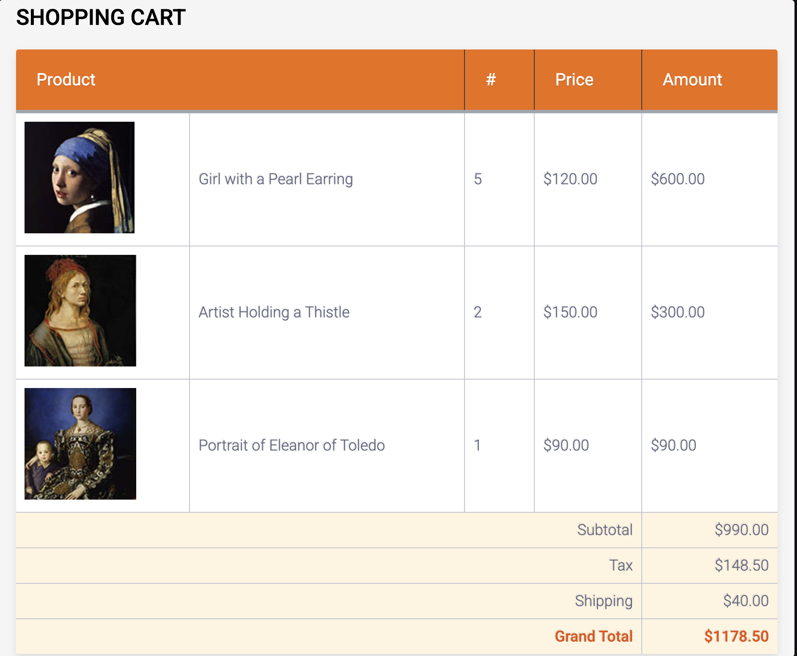

# JavaScript Shopping Cart

A simple shopping cart web application built using HTML, CSS, and JavaScript. This project demonstrates how JavaScript can be used to display shopping cart items, perform calculations, and generate HTML content dynamically.

## Project Overview

The shopping cart displays products with their images, names, quantities, prices, and total costs. JavaScript automatically calculates the subtotal, tax, shipping cost, and grand total based on the product information.

## Features

- Displays product information in a shopping cart table.
- Uses JavaScript arrays to store product details.
- Generates shopping cart rows dynamically using loops and functions.
- Calculates the total price for each product.
- Calculates a 15% sales tax.
- Applies a $40 shipping fee for orders with a subtotal of $1,000 or less.
- Provides free shipping when the subtotal exceeds $1,000.
- Displays prices with two decimal places.

## Technologies Used

- **HTML5** — Page structure and shopping cart table
- **CSS3** — Styling and layout
- **JavaScript** — Arrays, loops, functions, conditionals, and calculations

## How to Run

1. Download or clone this repository.
2. Open the project folder.
3. Open `BasicJavaScript.html` in a web browser.
4. View the shopping cart and its calculated totals.

## How It Works

The application uses JavaScript arrays to store product information, including filenames, product names, quantities, and prices.

The `calculateTotal()` function calculates the total cost of each product.

The `outputCartRow()` function generates shopping cart table rows using the product information.

JavaScript also calculates the subtotal, tax, shipping fee, and final total.

## What I Learned

Through this project, I practiced using JavaScript arrays, loops, functions, and conditional statements. I also learned how to generate HTML content dynamically and perform calculations using JavaScript.

## Future Improvements

- Add buttons to increase or decrease product quantities.
- Allow users to remove products from the cart.
- Update totals automatically when quantities change.
- Add a more responsive design for mobile devices.

## Project Screenshot

## Author

Biplov Parajuli

GitHub: [bparajuli1-arch](https://github.com/bparajuli1-arch)
